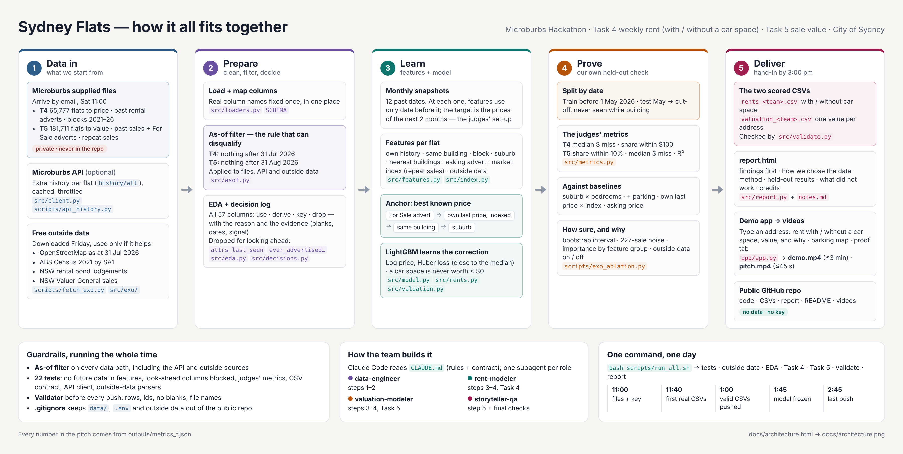
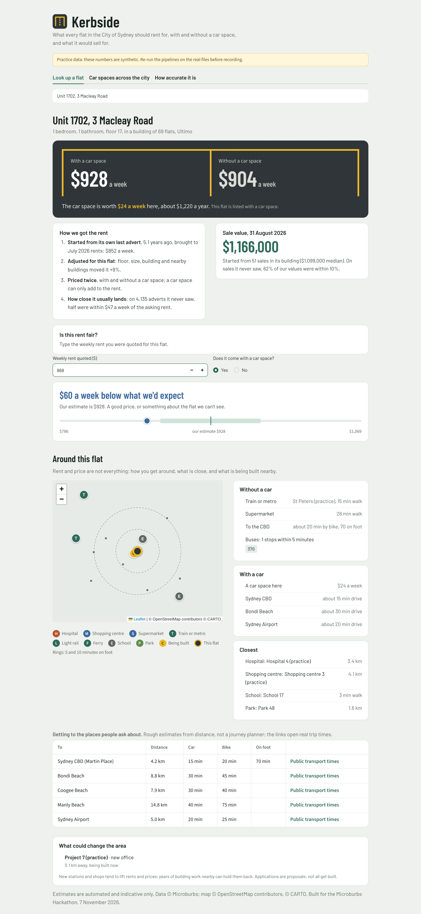

# Sydney Flats: rent and value for every flat in the City of Sydney

Microburbs Hackathon, Saturday 7 November 2026. Task 4 (weekly rent, with and without parking) and
Task 5 (sale value), City of Sydney.

> TODO on the day: replace every TODO with real numbers from `outputs/metrics_*.json`.



## What we built

Two estimates for every flat in the City of Sydney, from one pipeline:

- **Weekly rent** for all 65,777 flats, as at 31 July 2026, with and without a car space
  (`outputs/rents_<team>.csv`). The gap is what a car space is worth for that flat.
- **Sale value** for all 181,711 unit-style addresses on 31 August 2026 (`outputs/valuation_<team>.csv`).
- **Kerbside** (`app/app.py`), the app: type an address and get the weekly rent with and without a car space,
  the sale value and how we got them; check whether a quoted rent is fair; see what is around the flat
  (transport, shops, hospitals, bus routes, what is being built, rough travel times by car, bike and on foot);
  and a map of what a car space adds to rent across the City.



## Who it helps

- Tenants checking whether an asking rent is too high, and whether a car space is worth paying for.
- Landlords setting a rent that fits similar flats.
- Buyers and everyday investors checking a price before negotiating.

## The data

Microburbs Hackathon supplied files and API (City of Sydney key), used on the day only and not
included in this repo. Free outside data, used only if our held-out check shows it helps
(`outputs/exo_ablation.json`), and never included in this repo:

- OpenStreetMap as at 31 July 2026 (© OpenStreetMap contributors, ODbL): distance to transport, shops, parks, main roads.
- ABS Census 2021 by SA1 (© Commonwealth of Australia, CC BY 4.0): local median rent, income, household size.
- NSW Fair Trading rental bond lodgements: new-lease rents by postcode and bedrooms.
- NSW Valuer General bulk sales (contains property sales information provided under licence from the Valuer General NSW).

Full credits in `report.html`. TODO: delete any source the final model does not use.

## How we chose the data

Every column of the six supplied files has a recorded decision (used, derived, key or left out) and a
reason, backed by measured evidence: see **How we chose the data** in `report.html`
(table: `outputs/data_decisions.csv`, reasons: `src/decisions.py`). Two columns that would have let the
model see the future (`attrs_last_seen`, `ever_advertised_for_lease`) are left out on purpose.

## The clever step

TODO: one paragraph. Candidates: every feature is computed as of a snapshot date and the model learns
to predict two months ahead, exactly the judges' set-up; prices start from the best thing known about
that flat (its own advert, its own last price moved by a repeat-sales index, its building) and the
model only learns the correction; a monotone constraint keeps a car space worth zero or more.

## Results (our own held-out check)

| Task | Split date | Test events | Score | R² | Organisers' reference |
|---|---|---|---|---|---|
| 4 Rents | 2026-05-01 | TODO | median miss $TODO/wk, TODO% within $100 | TODO | $86/wk, 55.21% within $100 |
| 5 Values | 2026-05-01 | TODO | TODO% within 10% | TODO | 109 of 227 (48%) |

## How to run it

```bash
pip install -r requirements.txt
cp .env.example .env            # paste the team key; never commit .env
# put the six supplied CSVs in data/supplied/
TEAM_NAME="Your Team" bash scripts/run_all.sh
streamlit run app/app.py           # Kerbside, the demo app (local only)
```

One task at a time: `bash scripts/run_task.sh rents` or `bash scripts/run_task.sh valuation`.

## Files

`report.html` method and results · `pitch.mp4` 45 s · `demo.mp4` 3 min ·
`outputs/` hand-in CSVs and metrics · `src/` pipeline · `tests/` leakage and contract tests.
